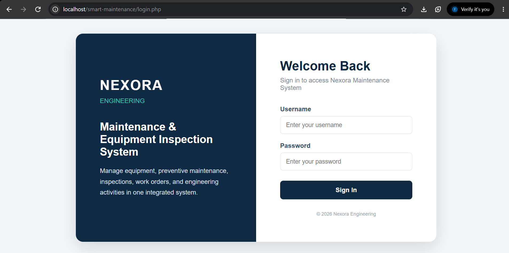
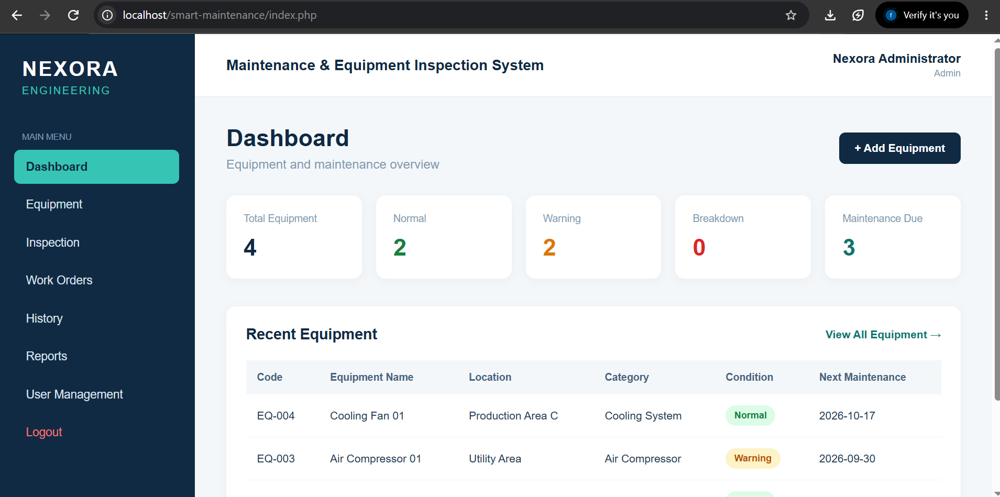
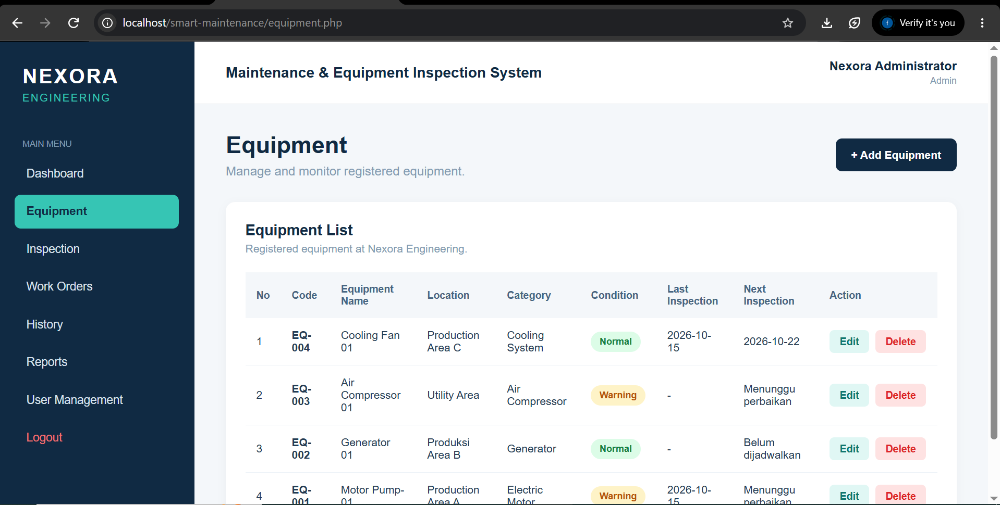
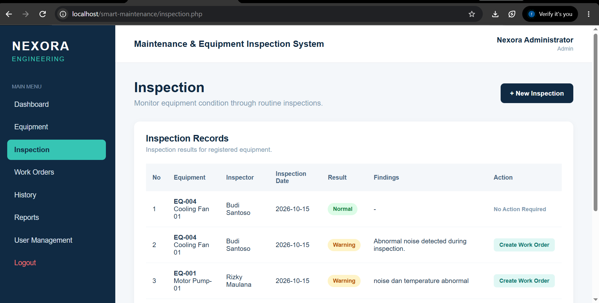
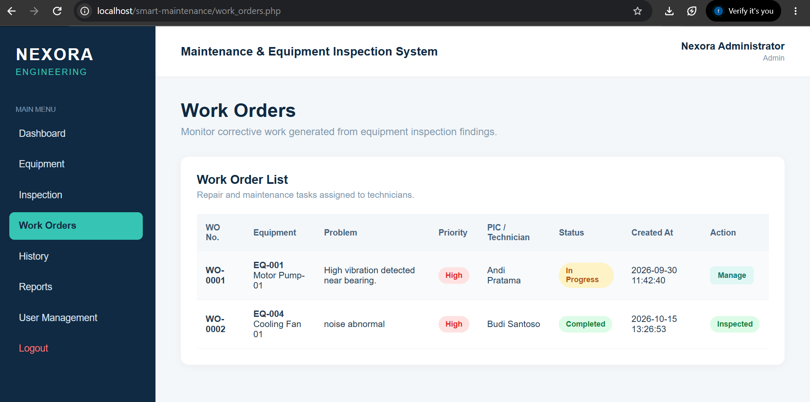
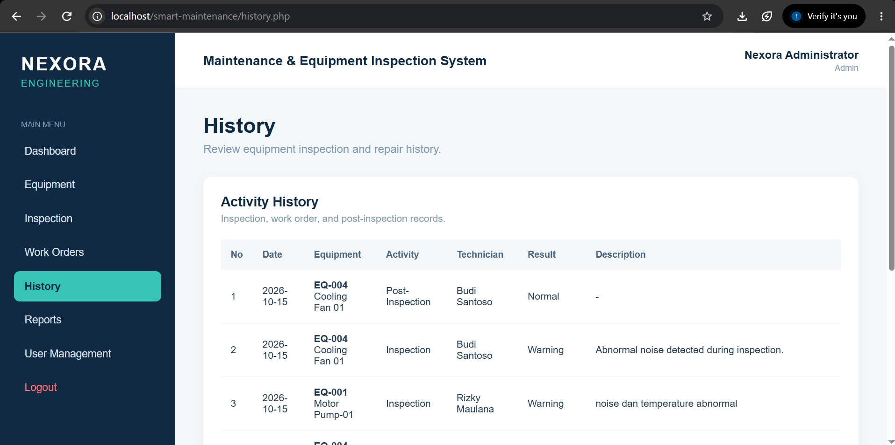
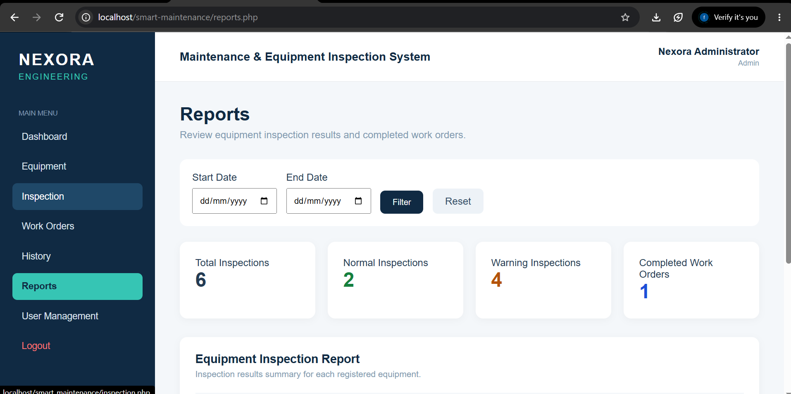
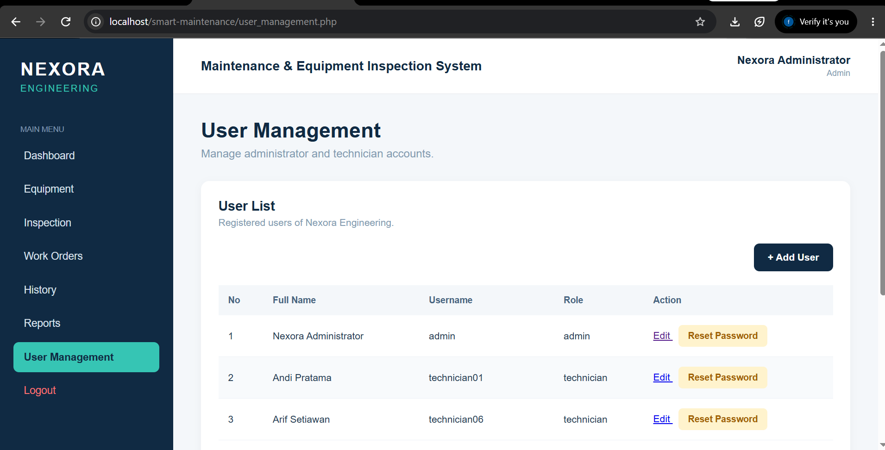

# Nexora Engineering — Equipment Inspection & Corrective Maintenance System

A web-based equipment inspection and corrective maintenance management system developed using **PHP and MySQL**.

This project is designed to support equipment monitoring, inspection records, corrective work orders, maintenance history, and reporting through a centralized web application.

## Features

### Dashboard
- Displays equipment statistics, including Normal, Warning, and Breakdown conditions.
- Provides an overview of equipment requiring maintenance.
- Displays recently registered equipment.

### Equipment Management
- Add, view, edit, and manage equipment information.
- Monitor equipment condition and maintenance schedules.

### Equipment Inspection
- Record equipment inspection results.
- Evaluate visual condition, noise, vibration, temperature, and leakage.
- Classify inspection results as Normal or Warning.

### Corrective Work Orders
- Create corrective work orders based on inspection findings.
- Assign technicians and set work order priorities.
- Track work order progress from Open to In Progress and Completed.
- Perform post-maintenance inspections.

### History and Reports
- View inspection and corrective maintenance activity history.
- Monitor inspection statistics and completed work orders.
- Review inspection results by equipment.

### User Management
- Role-based access for Administrator and Technician.
- Add and edit user accounts.
- Reset user passwords.
- Secure password storage using PHP password hashing.

## Technologies Used

- PHP
- MySQL
- HTML
- CSS
- JavaScript
- XAMPP
- Git and GitHub

## How to Run Locally

1. Install XAMPP.
2. Clone this repository into the `htdocs` directory.
3. Start Apache and MySQL from the XAMPP Control Panel.
4. Create a MySQL database named `nexora_maintenance`.
5. Import the database schema from your own local setup or prepared SQL export.
6. Create a local `koneksi.php` file with the appropriate MySQL connection settings.
7. Open the application at:

   `http://localhost/smart-maintenance/`

**Note:** The database configuration, SQL export, and login credentials are not included in this public repository. A properly configured database and user account are required to run the application.

## Project Workflow

Equipment Registration → Equipment Inspection → Corrective Work Order → Maintenance Completion → Post-Inspection → History and Reports

## Project Purpose

This project was developed as a personal software engineering portfolio to demonstrate practical skills in PHP web development, relational database integration, CRUD operations, authentication, role-based access control, and business workflow implementation.

## Developer

**Fatimah Arrajabiyah**

Electrical Engineering Graduate — Universitas Trunojoyo Madura

GitHub: https://github.com/fatimearjbyh-prog

## Project Status

Successfully developed, tested, and deployed a web-based Equipment Inspection & Corrective Maintenance System using PHP and MySQL.

The application was developed locally using XAMPP and deployed online using InfinityFree.

**Live Demo:** http://nexora-engineering.xo.je/login.php

**Status:** Completed and Deployed.

## Application Screenshots

### 1. Login Page
User authentication page for accessing the system.

### 2. Dashboard
Overview of equipment conditions and maintenance activities.

### 3. Equipment Management
Equipment data management and monitoring.

### 4. Equipment Inspection
Inspection form for recording equipment conditions.

### 5. Work Orders
Corrective maintenance work order management and progress tracking.

### 6. Maintenance History
Historical records of inspections and maintenance activities.

### 7. Reports
Equipment inspection and maintenance reporting.

### 8. User Management
User administration and role-based access management.

